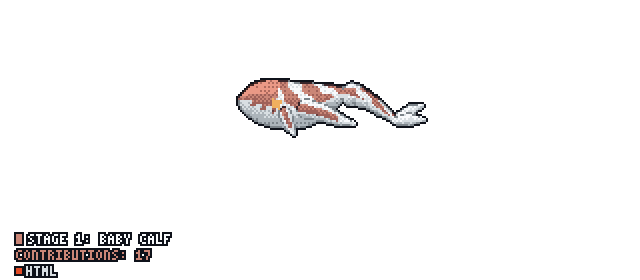

<!--
  Hamza Reda | GitHub Profile README
-->

<div align="center">

  <h1>Hey, I'm Hamza Reda 👋</h1>

  <h3>
    Aspiring Software Engineer
  </h3>

  <p>
    Full-Stack Development • Artificial Intelligence • Computer Science
  </p>

  

  <br/>

  

  <br/><br/>

  <a href="https://github.com/Hamza-Reda-Alashmawi">
    
  </a>

  <a href="https://github.com/Hamza-Reda-Alashmawi?tab=repositories">
    
  </a>

</div>

---

## 👨‍💻 About Me

I'm Hamza, an aspiring Software Engineer passionate about understanding how technology works and building useful software.

- 💻 Interested in Software Engineering and Full-Stack Development.
- 🤖 Exploring Artificial Intelligence and its real-world applications.
- 📚 Building a strong foundation in Computer Science through CS50.
- 🌱 Continuously learning programming languages, frameworks, and engineering concepts.
- 🎯 Focused on writing clean, maintainable, and efficient code.
- 🚀 Long-term goal: Build and launch my own technology products.

---

## 🛠️ Technologies & Tools

### Programming Languages

<p>
  
</p>

### Frontend Development

<p>
  
</p>

### Backend Development

<p>
  
</p>

### Development Tools

<p>
  
</p>

---

## 📚 Current Learning Journey

My learning path is focused on building strong fundamentals before moving into advanced engineering topics.

```text
Computer Science
       │
       ▼
      CS50
       │
       ▼
 Programming Fundamentals
       │
       ├── C
       │
       └── Python
              │
              ▼
       Web Development
              │
       ┌──────┴──────┐
       ▼             ▼
     HTML           CSS
       │             │
       └──────┬──────┘
              ▼
          JavaScript
              │
              ▼
          TypeScript
              │
              ▼
            React
              │
              ▼
          Node.js
              │
              ▼
          Express.js
              │
              ▼
          PostgreSQL
              │
              ▼
       Full-Stack Projects
              │
              ▼
     Artificial Intelligence
```

---

## 🎯 Engineering Goals

**Software Engineering**
- [ ] Master Data Structures & Algorithms.
- [ ] Understand Object-Oriented Programming.
- [ ] Learn Software Architecture.
- [ ] Study System Design.
- [ ] Build maintainable applications.

**Full-Stack Development**
- [ ] Master JavaScript and TypeScript.
- [ ] Build applications with React.
- [ ] Learn backend engineering with Node.js.
- [ ] Understand databases and API design.
- [ ] Build and deploy production-ready projects.

**Artificial Intelligence**
- [ ] Strengthen Python fundamentals.
- [ ] Learn Mathematics for AI.
- [ ] Study Machine Learning.
- [ ] Explore Deep Learning and Neural Networks.
- [ ] Build AI-powered applications.

---

## 🚀 Featured Projects

### 🌐 my-way

My personal Web Development learning journey.

A repository documenting my progress, experiments, and practical work while learning Web Development.

**Focus:**
- Responsive Web Design
- HTML & CSS
- JavaScript
- Frontend Development

<a href="https://github.com/Hamza-Reda-Alashmawi/my-way">
  
</a>

---

## 📊 GitHub Statistics

<div align="center">

  

  

  <br/><br/>

  

</div>

---

## 📈 Contribution Activity

<div align="center">

  

</div>

---

## 📫 Connect With Me

<div align="center">

  <a href="https://github.com/Hamza-Reda-Alashmawi">
    
  </a>

</div>

---

## ⚡ A Thought I Believe In

<div align="center">

  <h3>
    "Build. Learn. Improve. Repeat."
  </h3>

  <p>
    Great software is built through curiosity, consistency, and continuous improvement.
  </p>

</div>

---

<div align="center">

  <h3>🐋 My GitHub Ocean</h3>

  <a href="https://github.com/Hamza-Reda-Alashmawi/Hamza-Reda-Alashmawi/blob/main/README.md">
    
  </a>

  <br/>

  <sub>Thanks for visiting my profile! 🚀</sub>

</div>
